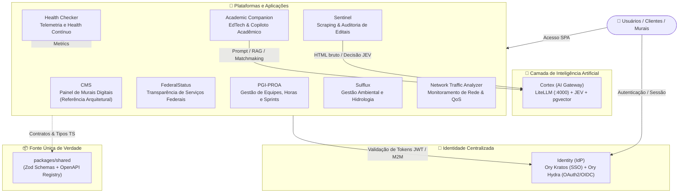
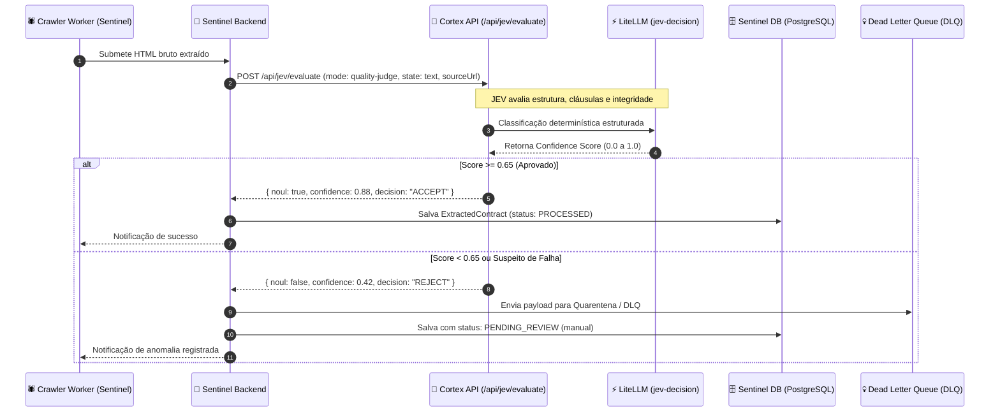
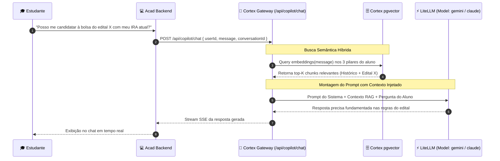

import { Card, CardGrid, Steps } from '@astrojs/starlight/components';

O ecossistema **Dorneles Laboratory** adota a arquitetura de **Monorepo por Acoplamento via Git Submodules**. Todos os projetos compartilham a mesma base técnica, padrões de segurança e infraestrutura, diferindo exclusivamente pelas suas regras de negócio e domínio.

---

## 🏛️ Visão Geral e Topologia de Microsserviços

O ecossistema é orquestrado de forma descentralizada, com comunicação orientada a eventos e APIs RESTful fortemente tipadas. A inteligência artificial é centralizada no **Cortex**, e a autenticação/autorização reside no **Identity**.



---

## 🔐 Identity: IdP Centralizado (SSO, OAuth2 & M2M)

Para evitar silos de autenticação e garantir conformidade com padrões modernos de segurança, o **Identity** atua como o único Provedor de Identidade (IdP) do ecossistema:

1. **Ory Kratos (Gerenciamento de Identidades & SSO):**
   - Responsável por registro, login, recuperação de senha, MFA (2FA TOTP), sessões baseadas em cookies HTTP-Only e self-service de perfis.
   - Endpoint público em `:4433` e endpoint administrativo em `:4434`.
2. **Ory Hydra (OAuth 2.0 & OpenID Connect):**
   - Emissão de tokens de acesso JWT criptografados (`argon2` / RS256) para fluxos de autorização (Authorization Code com PKCE para SPAs React).
   - Suporte nativo a **Client Credentials (M2M)** para comunicação segura de microsserviço para microsserviço (ex: Sentinel requisitando endpoints do Cortex).
   - Endpoint público em `:4444` e endpoint administrativo em `:4445`.
3. **Consistência em todos os serviços:**
   - Nenhum serviço secundário gerencia credenciais de usuário em tabelas próprias (`password_hash` reside apenas no Identity).
   - Backends validam claims JWT e correlation IDs em cada requisição.

---

## 🧠 Cortex: Hub Orquestrador Multi-Modelos e AI Gateway

O **Cortex** é o cérebro determinístico e generativo de todo o ecossistema. Nenhuma aplicação (como Acad ou Sentinel) se conecta diretamente a provedores externos de LLM (OpenAI, Anthropic, Gemini, Groq). Todas as requisições passam pelo Cortex através do **LiteLLM Proxy** e de seus módulos especializados.

### Módulos Principais do Cortex:

- **LiteLLM Proxy (`:4000`):** Unifica múltiplos provedores de inferência (Google Gemini, Groq Llama 3, OpenRouter, Anthropic Claude, DeepSeek) sob uma interface compatível com OpenAI. Gerencia balanceamento de carga, retries, rate limits e fallback semântico.
- **JEV (Judicial Evidence Validator / Decision Engine):** Motor de decisão rápida e determinística (System One).
- **Embeddings & Vector Store:** Armazenamento vetorial via extensão `pgvector` no PostgreSQL.
- **Copiloto Acadêmico:** Orquestração de conversas, memória contextual e RAG.

---

## ⚖️ Arquitetura do JEV (Decision Engine no Cortex)

O **JEV** é uma evolução do paradigma de LLMs para tomada de decisões determinísticas e binárias/categóricas de alta velocidade (70–500ms). Ao invés de gerar texto livre longo e custoso, o JEV recebe um `state` e retorna um score calibrado, um valor booleano probabilístico (`noul`) e opções categóricas (`choice`).

### Casos de Uso do JEV:

| Frente | Aplicação | Pergunta Avaliada | Saída do JEV | Ação Executada |
|---|---|---|---|---|
| **Auditoria de Qualidade** | Sentinel | *"Este conteúdo raspado é um edital de compras/concurso íntegro?"* | `noul` (0 a 1) | `< 0.65` → DLQ / Revisão Manual<br />`>= 0.65` → Salvo no Banco |
| **Matchmaking de Oportunidades** | Acad | *"Qual a compatibilidade entre este edital e o perfil do estudante?"* | `score` (0 a 100) + `reasons` | Ranqueamento de bolsas e vagas no painel |
| **Roteamento Semântico** | Cortex Gateway | *"Qual modelo de IA é o melhor custo-benefício para este prompt?"* | `choice` (groq / flash / pro / claude) | Encaminhamento para o alias correto do LiteLLM |
| **Escalation & Circuit Breaker** | Cortex Gateway | *"Este erro de inferência exige retry, fallback ou descarte?"* | `choice` (retry / escalate / discard) | Acionamento de Circuit Breaker |

### Diagrama de Sequência: Sentinel → JEV → DLQ / ACCEPT



---

## 📚 Fluxo de Embeddings e RAG (Cortex → Acad Copiloto)

O Copiloto do **Academic Companion** utiliza a arquitetura RAG (Retrieval-Augmented Generation) centralizada no Cortex para responder dúvidas dos estudantes baseando-se em seus dados acadêmicos reais e normativas da universidade.

### Os 3 Pilares Vetorizados do Estudante:
1. **Perfil Acadêmico:** Histórico escolar, curso, semestre, índice de rendimento (IRA), competências e interesses.
2. **Hub de Projetos:** Artigos em andamento, relatórios técnicos, repositórios e projetos de extensão.
3. **Memória Contextual:** Histórico de conversas anteriores, metas definidas e preferências de estudo.



---

## 🏢 Padrões Enterprise Implementados

Todos os projetos do ecossistema seguem rigorosamente os padrões de software corporativo:

### 1. Correlation ID (`x-request-id`)
Toda requisição HTTP originada em qualquer frontend ou cliente externo recebe um cabeçalho `x-request-id` (UUID v4). Esse identificador é:
- Propagado através de chamadas entre serviços via Axios / Fetch.
- Registrado em todos os logs gerados pelo Pino.
- Anexado a spans do OpenTelemetry para rastreamento no Jaeger.

### 2. RFC 7807 — Problem Details for HTTP APIs
Erros HTTP nunca são retornados como strings planas ou objetos arbitrários. Todas as respostas de erro (400, 401, 403, 404, 422, 500) utilizam o content-type `application/problem+json`:

```json
{
  "type": "https://errors.dorneles.dev/validation-error",
  "title": "Unprocessable Entity",
  "status": 422,
  "detail": "O campo 'email' informado é inválido.",
  "instance": "/api/v1/users",
  "errors": [
    {
      "field": "email",
      "message": "Formato de e-mail inválido"
    }
  ],
  "requestId": "9b1deb4d-3b7d-4bad-9bdd-2b0d7b3dcb6d",
  "timestamp": "2026-09-29T16:00:00.000Z"
}
```

### 3. Graceful Shutdown
Todos os backends implementam tratamento de sinais `SIGTERM` e `SIGINT`:
- Interrompem a aceitação de novas conexões HTTP no servidor Express.
- Aguardam a conclusão de requisições ativas com timeout de segurança (ex: 10 segundos).
- Encerram graciosamente pools de conexão do Prisma ORM (`await prisma.$disconnect()`).
- Finalizam conexões ativas com filas, Redis e collectors OpenTelemetry.

### 4. Health Checks Padronizados
Todos os serviços expõem rotas de verificação de integridade consumidas pelo motor do **Health Checker**:
- `GET /health/live`: Prova de vivacidade do processo HTTP.
- `GET /health/ready`: Prova de prontidão (testa conexão com PostgreSQL via `SELECT 1`, Redis e storage).

### 5. Observabilidade Distribuída (Pino + OpenTelemetry + Jaeger)
- **Logs estruturados em JSON** gerados por `pino` e `pino-http` com níveis de severidade padronizados (`info`, `warn`, `error`, `fatal`).
- **OpenTelemetry SDK** instrumentando requisições HTTP, queries do Prisma e chamadas externas.
- **Jaeger UI** disponível localmente para inspeção de traces e latências de gargalos.

### 6. Clean Architecture & Fonte Única de Verdade (`packages/shared`)
O fluxo interno de dados em todos os backends segue estritamente três camadas desacopladas:
```
Requisição HTTP → Controller (validação safeParse do Zod) → Service (regras de negócio puras) → Prisma ORM → Banco
```
Nenhum schema Zod ou tipo TypeScript de entidade é duplicado no frontend ou no backend. Todos são definidos em `packages/shared`, compilados e consumidos como pacote local via sub-módulo Git.
