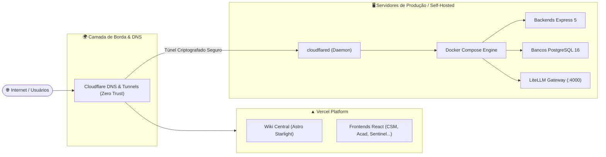

import { Steps, Card, CardGrid } from '@astrojs/starlight/components';

# Deploy e Infraestrutura

A infraestrutura do ecossistema Dorneles Laboratory foi projetada para combinar alta disponibilidade, segurança de ponta a ponta e custo operacional eficiente.

---

## 🏗️ Topologia de Hospedagem

---

## 🚀 Camadas de Entrega

### 1. Frontends & Wiki (Vercel)
- As aplicações SPA (React 19 / Vite 7) e a própria Wiki (Astro Starlight) são construídas e publicadas na **Vercel**.
- **Preview Deployments:** Cada Pull Request aberto no GitHub gera automaticamente uma URL de homologação temporária para validação visual antes do merge.
- **Edge Caching:** Distribuição global de assets estáticos com invalidação instantânea.

### 2. Backends & Microsserviços (Docker Compose)
- Os backends Express 5, bancos de dados PostgreSQL, instâncias do MinIO S3 e o LiteLLM são executados em containers gerenciados via `docker-compose.prod.yml`.
- Cada microsserviço roda em uma rede de bridge isolada (`bridge network`), permitindo que a porta interna do container (`5432` para banco, `5000` para backend) não conflite com outros projetos no mesmo host físico.

### 3. Cloudflare Tunnels (Conectividade Segura Zero Trust)
- Nenhuma porta de backend ou banco de dados é exposta diretamente na internet ou através de abertura manual de portas em roteadores (*port forwarding*).
- O tráfego de entrada é intermediado pelo daemon **`cloudflared`**, que estabelece túneis bidirecionais criptografados para a rede global da Cloudflare.
- Oferece proteção nativa contra ataques DDoS, terminação SSL automática e políticas de acesso Zero Trust para rotas administrativas.

---

## 🔄 Pipeline de CI/CD (GitHub Actions)

Todo repositório possui uma pipeline automatizada disparada em Pull Requests e merges na branch `main`:

<Steps>
1. **Lint e Tipagem Estrita**
   Validação de sintaxe TypeScript (`tsc --noEmit`) para garantir zero `any` implícito em todos os pacotes.

2. **Testes Automatizados (Vitest)**
   Execução dos testes unitários e de integração de controllers, services e schemas Zod.

3. **Validação de Build**
   Compilação do `@lib/shared`, da API Express (`npm run build`) e dos frontends Vite.

4. **Deploy Automatizado**
   Após aprovação do PR e merge em `main`, os webhooks de deploy da Vercel e o runner de orquestração Docker disparam a atualização contínua dos serviços.
</Steps>
