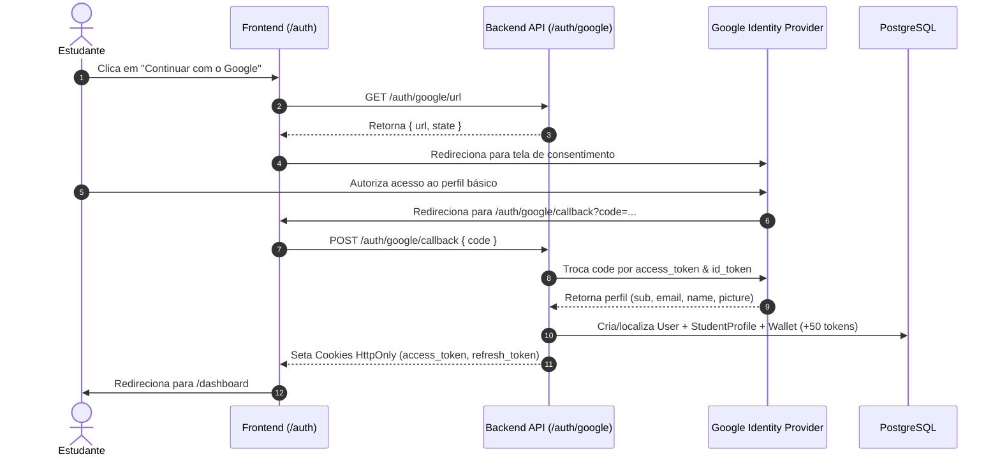

# 🔐 Autenticação & Integrações OAuth 2.0

O **Academic Companion (`acad`)** adota uma arquitetura de autenticação moderna e segura, projetada para garantir zero vazamento de credenciais via JavaScript (XSS) através de cookies **HttpOnly**, suporte nativo a login federado institucional e pessoal via **Google OAuth 2.0**, e conexão direta com a **LinkedIn Developer Platform** para publicação automática de conquistas acadêmicas.

---

## 🛡️ 1. Princípios de Segurança & Gestão de Sessão

### Cookies HttpOnly vs. LocalStorage
Para evitar vulnerabilidades de roubo de sessão através de ataques Cross-Site Scripting (XSS):
- Os tokens JWT (`accessToken` e `refreshToken`) são emitidos como cookies **HttpOnly**, com atributos `SameSite=Lax` (ou `Strict`) e `Secure=true` em ambiente de produção (HTTPS).
- O frontend discente e administrativo **nunca tem acesso direto à string do token**, eliminando riscos de leitura maliciosa no DOM.
- As rotas protegidas enviam automaticamente os cookies para a API backend (`apps/backend`) por meio de `credentials: 'include'`.

---

## 🌐 2. Google OAuth 2.0 & One-Tap

A autenticação com o Google permite que estudantes acessem a plataforma instantaneamente, com suporte prioritário a e-mails institucionais (como `@ecomp.ufsm.br` e `@ufsm.br`).

### Fluxo de Redirecionamento (Authorization Code Flow)

### Endpoints Oficiais do Google OAuth

| Método | Rota | Descrição |
|---|---|---|
| `GET` | `/api/auth/google/url` | Retorna a URL segura de consentimento com state assinado anti-CSRF |
| `POST` | `/api/auth/google/callback` | Recebe o código temporário, valida no Google e inicia a sessão |
| `POST` | `/api/auth/google/one-tap` | Recebe o ID Token emitido pelo componente Google One-Tap e autentica |

---

## 💼 3. Integração LinkedIn Developer Platform

O **Academic Companion** integra-se à API oficial do LinkedIn para transformar vivências e certificações em publicações de alto impacto profissional.

### Permissões & Produtos Ativos

1. **Share on LinkedIn (`w_member_social`):** Permite a publicação direta de posts no feed oficial do usuário através da API UGC (`/v2/ugcPosts`).
2. **Sign In with LinkedIn using OpenID Connect (`openid`, `profile`, `email`):** Permite sincronização da foto, identificador profissional e vanity URL.

### Endpoints da Integração LinkedIn

| Método | Rota | Descrição |
|---|---|---|
| `GET` | `/api/integrations/linkedin/status` | Informa se a conta está conectada e os metadados do perfil |
| `GET` | `/api/integrations/linkedin/auth-url` | Gera URL de consentimento OAuth do LinkedIn |
| `POST` | `/api/integrations/linkedin/callback` | Conclui o fluxo de autorização e armazena o access token |
| `POST` | `/api/integrations/linkedin/manual` | Permite conexão rápida fornecendo a URL pública do perfil |
| `DELETE` | `/api/integrations/linkedin` | Desconecta a conta e revoga credenciais salvas |
| `POST` | `/api/integrations/linkedin/share` | Publica o texto gerado diretamente no feed do LinkedIn |
| `POST` | `/api/integrations/linkedin/generate-post` | Gera posts em 3 variações de tom utilizando IA Gemini |
| `POST` | `/api/integrations/linkedin/optimize-profile` | Gera Headline, resumo e sugestões de competências |

---

## 🎁 4. Onboarding Automático & Carteira de Tokens

Ao entrar via Google pela primeira vez:
1. Um registro de usuário (`User`) é criado com papel `STUDENT`.
2. O perfil acadêmico (`StudentProfile`) é auto-configurado com base no domínio institucional (ex.: UFSM).
3. A carteira (`UserWallet`) é provisionada com **50 tokens gratuitos** de boas-vindas com transação do tipo `WELCOME_BONUS`.
4. Uma notificação interna de boas-vindas é enviada à central de notificações do estudante.
