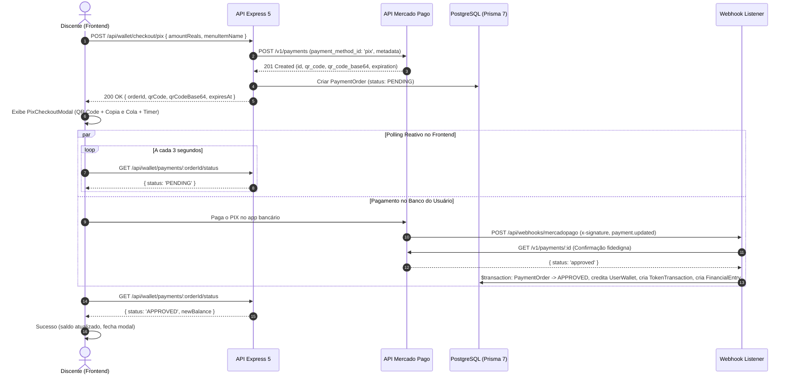

# Checkout de Pagamentos Mercado Pago com PIX

O **Academic Companion (`acad`)** integra o gateway de pagamento **Mercado Pago** com foco primordial em **PIX**, permitindo uma experiência instantânea, segura e com conciliação automática para estudantes e pesquisadores.

---

## 1. Casos de Uso Suportados

1. **Apoio ao Desenvolvimento & Recarga Livre de Tokens (`/carteira`):**
   - Recargas a partir de **R$ 2,50** diretamente na Carteira de Tokens.
   - Cálculo automático de bônus progressivos por faixa de contribuição.
2. **Fechamento de Comandas Gastronômicas (`/bistro` ou `/planos`):**
   - Aquisição de pratos do cardápio e gorjetas de apoio com conversão direta em tokens de inteligência artificial.

---

## 2. Fluxo Arquitetural e Conciliação em Tempo Real



---

## 3. Endpoints da Plataforma

| Método | Rota | Autenticação | Descrição |
|---|---|---|---|
| `POST` | `/api/wallet/checkout/pix` | Sim (`cookieAuth`) | Cria ordem de pagamento PIX e retorna QR Code e Copia-e-Cola |
| `GET` | `/api/wallet/payments/:orderId/status` | Sim (`cookieAuth`) | Consulta status em tempo real com suporte a polling |
| `POST` | `/api/plans/checkout-pix` | Sim (`cookieAuth`) | Gera ordem PIX para comanda de planos/pratos |
| `POST` | `/api/webhooks/mercadopago` | Pública (HMAC SHA-256) | Receptor oficial de notificações de pagamento do Mercado Pago |
| `POST` | `/api/wallet/payments/:orderId/simulate-approval` | Sim (Ambiente Dev) | Simula aprovação imediata em desenvolvimento |

---

## 4. Variáveis de Ambiente Necessárias

No arquivo `.env.production` do `apps/backend`:

```env
# Mercado Pago Gateway
MERCADOPAGO_ACCESS_TOKEN=APP_USR-xxxxxxxxxxxxxxxxxxxx
MERCADOPAGO_PUBLIC_KEY=APP_USR-xxxxxxxxxxxxxxxxxxxx
MERCADOPAGO_WEBHOOK_SECRET=xxxxxxxxxxxxxxxxxxxxxxxx
API_BASE_URL=https://acad.dorneles.dev
```

> **Modo Sandbox / Desenvolvimento:** Caso `MERCADOPAGO_ACCESS_TOKEN` não seja informado, o sistema entra automaticamente em modo simulado, gerando QR Code SVG representativo e disponibilizando o botão *"Simular Pagamento Aprovado"* no modal.
