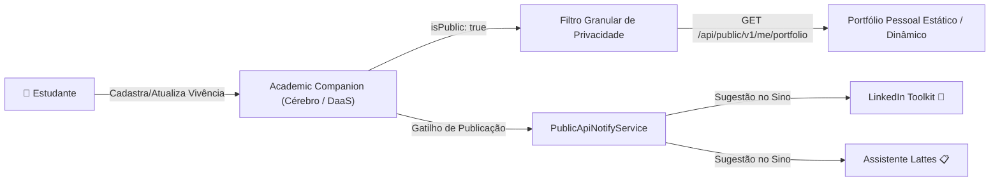

# 🌐 Public API & Headless CMS: A Fonte Única de Verdade (DaaS)

Gerenciar a presença digital e acadêmica contemporânea frequentemente incorre em retrabalho excessivo: atualizar o Currículo Lattes no CNPq, cadastrar projetos em portfólios estáticos (Astro, Next.js, Hugo), divulgar avanços no LinkedIn e manter anotações de pesquisa em diários isolados.

O **Academic Companion (Acad)** resolve essa fragmentação assumindo o papel de **Single Source of Truth** (Fonte Única da Verdade) e **Data as a Service (DaaS)** da trajetória universitária e científica do estudante.

---

## 🏛️ Princípios de Arquitetura & Separação de Responsabilidades



### 1. Zero Endpoints Públicos Expostos sem Chave
Nenhum endpoint de dados de estudante é acessível publicamente sem autenticação. Qualquer cliente externo (portfólios, blogs acadêmicos ou ferramentas de terceiros) **deve obrigatoriamente** fornecer uma chave de API válida no header:
```http
X-Acad-Api-Key: acad_live_<64_hex_chars>
```
ou:
```http
Authorization: ApiKey acad_live_<64_hex_chars>
```

### 2. Rotas Relativas ao Titular da Chave (`/me`)
Em vez de expor identificadores ou usernames nas URLs (que poderiam sofrer scraping ou colisões de rotas), a API utiliza o padrão de **contexto relativo ao titular da credencial**:
- `GET /api/public/v1/me/portfolio`
- `GET /api/public/v1/me/experiences`
- `GET /api/public/v1/me/profile`

A chave de API recebida é submetida a hashing criptográfico **SHA-256** no banco de dados relacional. O titular da chave é identificado e seus dados são filtrados estritamente com base na flag de privacidade `isPublic: true`.

### 3. Rate Limit Dedicado
Para proteger a infraestrutura contra abusos e scraping automatizado, a rota possui um rate limiter dedicado de:
- **100 requisições por hora por Chave de API** (HTTP 429 RFC 7807).

---

## 🔑 Ciclo de Vida da Chave de API

| Ação | Mecanismo | Segurança |
|---|---|---|
| **Geração** | `POST /api/public/v1/keys` | Gera 32 bytes aleatórios de alta entropia (`crypto.randomBytes(32)`). A chave em texto puro (`plainKey`) é exibida **uma única vez** no modal. |
| **Persistência** | Hash SHA-256 | Somente o digest hexadecimal do SHA-256 é armazenado na tabela `public_api_keys`. |
| **Identificação Visual** | Prefixo de 18 caracteres | A interface exibe apenas o prefixo identificador (ex: `acad_live_7b3f9c2d...`). |
| **Cota Máxima** | 5 Chaves Ativas | Limita o excesso de credenciais abertas por usuário. |
| **Revogação** | `DELETE /api/public/v1/keys/:keyId` | Revoga imediatamente a chave (`isActive: false`), mantendo o log de auditoria. |

---

## 📡 Endpoints da Public API

### 1. Gerenciamento de Chaves (Sessão do Usuário / JWT)

| Método | Rota | Descrição |
|---|---|---|
| `POST` | `/api/public/v1/keys` | Gera uma nova chave de API com label e validade opcional |
| `GET` | `/api/public/v1/keys` | Lista as chaves geradas pelo estudante e estatísticas de uso |
| `DELETE` | `/api/public/v1/keys/:keyId` | Revoga imediatamente uma chave de API |

### 2. Consumo de Dados (Cliente Externo / Header `X-Acad-Api-Key`)

#### `GET /api/public/v1/me/portfolio`
Retorna a estrutura completa para renderização de portfólios pessoais externos, agregando perfil institucional e todas as vivências práticas marcadas como públicas.

**Exemplo de Resposta (JSON):**
```json
{
  "profile": {
    "name": "Fernando Dorneles da Silva",
    "avatarUrl": "https://storage-acad.dorneles.dev/avatars/fernando.webp",
    "bio": "Pesquisador em Sistemas Distribuídos e Inteligência Artificial.",
    "university": "Universidade Federal de Santa Maria (UFSM)",
    "course": "Ciência da Computação",
    "currentSemester": 8,
    "interests": ["Sistemas Distribuídos", "Machine Learning", "Cloud Native"],
    "lattesUrl": "http://lattes.cnpq.br/1234567890123456",
    "linkedinUrl": "https://linkedin.com/in/fernandodorneles",
    "githubUrl": "https://github.com/dorneles"
  },
  "experiences": [
    {
      "id": "e4c5f890-3b21-419b-8f0a-6f7d983c21a0",
      "title": "Iniciação Científica em Agentes Autônomos",
      "type": "RESEARCH",
      "status": "IN_PROGRESS",
      "role": "Pesquisador Bolsista",
      "institution": "Laboratório de IA / UFSM",
      "advisor": "Prof. Dr. Dorneles",
      "startDate": "2025-03-01T00:00:00.000Z",
      "endDate": null,
      "weeklyHours": 20,
      "totalHours": 320,
      "description": "Pesquisa e implementação de orquestração multi-agente em larga escala.",
      "skills": ["TypeScript", "Docker", "Prisma", "Python"],
      "publishedAt": "2026-10-19T14:30:00.000Z"
    }
  ],
  "totalExperiences": 1,
  "generatedAt": "2026-10-19T15:20:00.000Z"
}
```

---

## 🚀 Integração com Portfólios Pessoais (Exemplos Práticos)

### Consumo no Astro / Next.js / Nuxt (Server-Side)

```typescript
// Exemplo em TypeScript nativo (compatível com Next.js Server Components, Astro e Remix)
export async function getAcademicPortfolio() {
  const apiKey = process.env.ACAD_API_KEY;

  const response = await fetch('https://api-acad.dorneles.dev/api/public/v1/me/portfolio', {
    headers: {
      'X-Acad-Api-Key': apiKey!,
    },
    next: { revalidate: 3600 }, // Cache incremental de 1 hora
  });

  if (!response.ok) {
    throw new Error(`Falha ao obter dados do Acad: ${response.status}`);
  }

  return response.json();
}
```

### Consumo via cURL

```bash
curl -X GET "https://api-acad.dorneles.dev/api/public/v1/me/portfolio" \
  -H "X-Acad-Api-Key: acad_live_7b3f9c2d1e0a8b4c5d6e7f8a9b0c1d2e3f4a5b6c7d8e9f0a1b2c3d4e5f6a7b8c"
```

---

## ⚡ Gatilho Automático: Sincronização LinkedIn e Lattes

Quando o estudante cria uma nova experiência prática com `isPublic: true` ou altera uma vivência existente de *Privada* para *Pública*, o `PublicApiNotifyService` entra em ação imediatamente:

1. **Gera Evento de Auditoria:** Registra na tabela `public_api_events` o payload e o snapshot publicado.
2. **Sinaliza o LinkedIn Toolkit:** Insere uma notificação no sino do estudante convidando-o a abrir o **LinkedIn Impact Builder** (`/toolkit/linkedin`) para gerar uma postagem profissional adaptada com IA.
3. **Sinaliza o Assistente Lattes:** Insere uma notificação convidando o discente a abrir o **Assistente Lattes** (`/toolkit/lattes`) para conferir em qual aba e modalidade do Currículo CNPq a atividade deve ser lançada.
