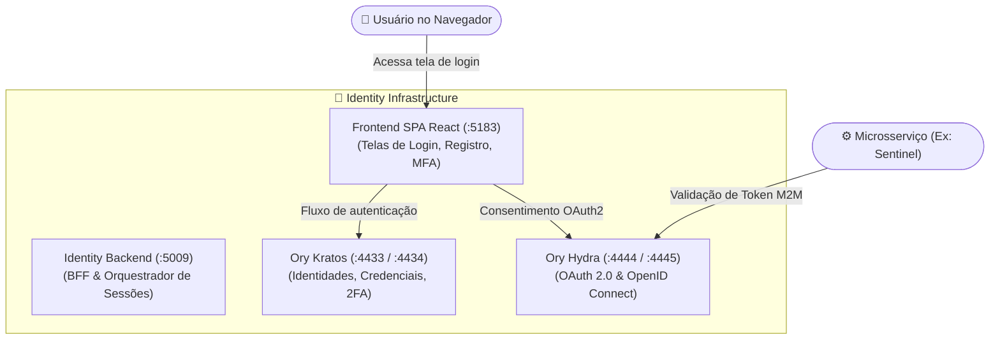

import { Card, CardGrid, Badge } from '@astrojs/starlight/components';

# Identity (Central Identity Provider)

<Badge text="Segurança & Autenticação Central" variant="danger" size="large" />

O **Identity** é o serviço central de autenticação, autorização e gerenciamento de identidades de todo o ecossistema Dorneles Laboratory. Ele implementa o conceito de **Single Sign-On (SSO)** e federação de identidade para garantir que um único cadastro de usuário seja reconhecido em todas as plataformas (CMS, Acad, FederalStatus, PGI-PROA, Sulflux, etc.).

---

## 🏛️ Componentes de Arquitetura

O Identity opera integrando dois motores consolidados do ecossistema Ory:

### 1. Ory Kratos (Gestão de Identidades & SSO)
- **Registro e Login:** Suporte a e-mail/senha, recuperação de conta e verificação por e-mail.
- **Segurança Avançada:** Autenticação em dois fatores (2FA TOTP), webauthn e hashing moderno de senhas com `argon2`.
- **Sessões Unificadas:** Cookies de sessão HTTP-Only seguros com suporte a domínio amplo.

### 2. Ory Hydra (OAuth 2.0 & OpenID Connect)
- **Autorização para SPAs:** Fluxo Authorization Code com PKCE para todas as aplicações React.
- **Machine-to-Machine (M2M):** Emissão e introspecção de tokens via fluxo Client Credentials, permitindo que microsserviços se autentiquem mutuamente com escopos granulares de permissão.

---

## 🗺️ Portas e Serviços Locais

| Serviço | Porta Host | Porta Container | Descrição |
|---|:---:|:---:|---|
| **backend** | `5009` | `5009` | API BFF do Identity |
| **frontend** | `5183` | `5173` | SPA de Login, Registro e Perfil do Usuário |
| **admin** | `5184` | `5173` | Painel Administrativo de Usuários e Tenants |
| **db (PostgreSQL)** | `5450` | `5432` | Banco de dados central de identidades |
| **kratos-public** | `4433` | `4433` | API pública do Ory Kratos (self-service) |
| **kratos-admin** | `4434` | `4434` | API administrativa do Ory Kratos |
| **hydra-public** | `4444` | `4444` | API pública do Ory Hydra (OAuth2/OIDC) |
| **hydra-admin** | `4445` | `4445` | API administrativa do Ory Hydra |
| **jaeger** | `16695` | `16686` | UI de rastreamento OpenTelemetry |
| **minio-api** | `9011` | `9000` | Armazenamento de avatares e documentos |
| **minio-console** | `9012` | `9001` | Console do MinIO |

---

## 🔒 Benefícios para o Ecossistema

<CardGrid>
  <Card title="Zero Duplicação de Senhas" icon="approve-check">
    Nenhuma aplicação satélite armazena hashes de senha. Toda validação de credencial ocorre unicamente no Identity.
  </Card>

  <Card title="Logout Global (SLO)" icon="close">
    Ao revogar a sessão no Identity, o encerramento propaga-se de forma coordenada para todas as sessões abertas.
  </Card>

  <Card title="Tokens M2M Auditáveis" icon="setting">
    Comunicação entre serviços (ex: Sentinel requisitando Cortex) é autenticada por tokens com tempo de vida curto e escopo restrito.
  </Card>

  <Card title="Compliance e Governança" icon="document">
    Trilhas de auditoria para tentativas de login suspeitas, bloqueios por força bruta e conformidade com LGPD.
  </Card>
</CardGrid>
