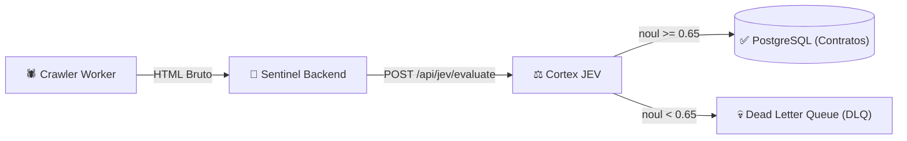

import { Card, CardGrid, Badge } from '@astrojs/starlight/components';

# Sentinel

<Badge text="Web Scraping & Pipeline de Editais" variant="caution" size="large" />

O **Sentinel** é a plataforma de extração automatizada de editais, licitações e contratos públicos a partir de diários oficiais e portais de compras governamentais (como Compras.gov.br e portais de universidades federais). O sistema opera uma infraestrutura distribuída de crawlers híbridos combinada com auditoria semântica.

---

## 🕷️ Fluxo de Extração e Integração com Cortex JEV

Para garantir máxima fidelidade dos dados extraídos e evitar poluição do banco com ruídos de HTML malformatados ou falsos positivos:

1. **Crawler Worker:** Coleta páginas de portais pré-configurados utilizando estratégias estáticas (Cheerio/HTTP) ou dinâmicas (Puppeteer/Playwright para SPAs com JavaScript pesado).
2. **Avaliação pelo JEV (Cortex):** O HTML e metadados extraídos são submetidos para o endpoint `POST /api/jev/evaluate` com modo `quality-judge`.
3. **Decisão Automatizada:**
   - **Score >= 0.65 (`ACCEPT`):** O documento é considerado íntegro e estruturado, sendo salvo em `ExtractedContract` com status `PROCESSED`.
   - **Score < 0.65 (`REJECT`):** O documento é encaminhado para a **DLQ (Dead Letter Queue)** e registrado como `PENDING_REVIEW` para triagem manual de um operador.

---

## 🗺️ Portas e Serviços Locais

| Serviço | Porta Host | Porta Container | Descrição |
|---|:---:|:---:|---|
| **backend** | `5010` | `5010` | API RESTful e orquestrador de jobs do Sentinel |
| **frontend** | `5186` | `5173` | Painel operacional do Sentinel |
| **db (PostgreSQL)** | `5452` | `5432` | Banco de dados dos contratos extraídos |
| **jaeger** | `16697` | `16686` | UI de rastreamento OpenTelemetry |
| **otlp-grpc** | `4335` | `4317` | Coletor OpenTelemetry gRPC |
| **otlp-http** | `4336` | `4318` | Coletor OpenTelemetry HTTP |
| **minio-api** | `9015` | `9000` | Armazenamento de PDFs originais dos editais |
| **minio-console** | `9016` | `9001` | Console do MinIO |

---

## 🛠️ Principais Recursos

<CardGrid>
  <Card title="Agendamento Recorrente de Scrapers" icon="setting">
    Configuração de periodicidade cron por portal monitorado, respeitando rate limits e robots.txt.
  </Card>

  <Card title="Normalização de Metadados" icon="document">
    Extração estruturada de número de processo, órgão licitante, data limite de proposta, valor estimado e anexos.
  </Card>

  <Card title="Quarentena e Painel de Auditoria" icon="warning">
    Interface dedicada para analistas inspecionarem itens rejeitados pelo JEV, com reprocessamento manual em um clique.
  </Card>

  <Card title="Disponibilização via API M2M" icon="rocket">
    Endpoints autenticados via token M2M emitido pelo Identity para que o Academic Companion e outros serviços consumam os editais normalizados.
  </Card>
</CardGrid>
